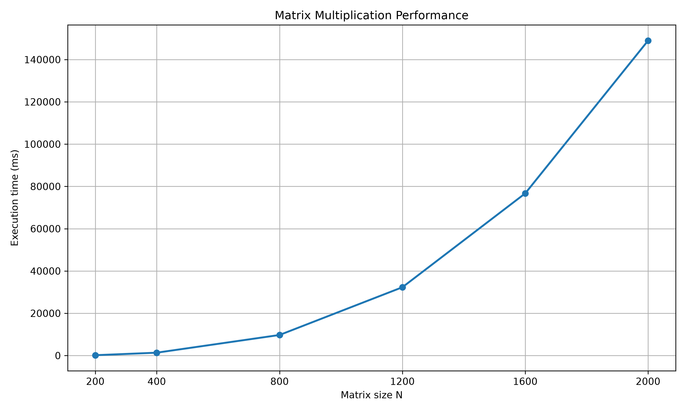

# MatrixMultiplication

Лабораторная работа №1 по дисциплине «Параллельное программирование».

## 📌 Описание

Программа реализует **последовательное умножение двух квадратных матриц** на языке C++.

Входные данные — две квадратные матрицы, которые автоматически генерируются программой и сохраняются в текстовые файлы.

Для исследования производительности проведены эксперименты для матриц следующих размеров:

- 200 × 200
- 400 × 400
- 800 × 800
- 1200 × 1200
- 1600 × 1600
- 2000 × 2000

Для каждого эксперимента измеряется время выполнения, рассчитывается количество арифметических операций, сохраняются исходные матрицы и результат умножения.

Корректность результатов проверяется независимо с помощью **Python + NumPy**.

---

## 📁 Структура проекта

```text
.
├── MatrixMultiplication.cpp    # основная программа C++
├── verify.py                   # проверка результатов через NumPy
├── plot.py                     # построение графика
├── experiments.csv             # результаты экспериментов
├── performance.png             # график производительности
│
├── data/
│   ├── matrixA_200.txt
│   ├── matrixB_200.txt
│   ├── matrixA_400.txt
│   ├── matrixB_400.txt
│   ├── ...
│   ├── matrixA_2000.txt
│   └── matrixB_2000.txt
│
└── results/
    ├── result_200.txt
    ├── result_400.txt
    ├── ...
    └── result_2000.txt
```

---

## ⚙️ Требования

| Инструмент | Версия |
|---|---|
| C++ | C++23 |
| Visual Studio | актуальная версия с поддержкой C++23 |
| Python | 3.x |
| NumPy | актуальная версия |
| Matplotlib | актуальная версия |

Установка Python-зависимостей:

```bash
pip install numpy matplotlib
```

---

## 🔢 Алгоритм умножения

Для двух матриц `A` и `B` размера `N × N` результирующая матрица `C` вычисляется по формуле:

$$
C_{ij} = \sum_{k=0}^{N-1} A_{ik}B_{kj}
$$

В программе используется классический тройной цикл:

```cpp
for (size_t i = 0; i < n; ++i)
{
    for (size_t k = 0; k < n; ++k)
    {
        for (size_t j = 0; j < n; ++j)
        {
            C[i][j] +=
                static_cast<long long>(A[i][k]) *
                B[k][j];
        }
    }
}
```

Распараллеливание в данной реализации не используется.

---

## 📊 Сложность

Для каждой пары индексов выполняются операции умножения и сложения.

Количество умножений:

$$
N^3
$$

Количество сложений в данной реализации:

$$
N^3
$$

Общее количество арифметических операций:

$$
2N^3
$$

Вычислительная сложность:

$$
O(N^3)
$$

Пространственная сложность:

$$
O(N^2)
$$

При увеличении размера матрицы в 2 раза количество операций возрастает примерно в 8 раз:

$$
2^3 = 8
$$

---

## 🚀 Запуск

### 1. Сборка C++

Проект собирается в Visual Studio в конфигурации:

```text
Debug x64
```

Запуск:

```text
Ctrl + F5
```

Программа автоматически:

1. создаёт матрицы нужных размеров;
2. сохраняет их в `data/`;
3. перемножает матрицы;
4. измеряет время выполнения;
5. сохраняет результаты в `results/`;
6. записывает результаты экспериментов в `experiments.csv`;
7. запускает `verify.py`.

> Эксперимент с матрицей `2000 × 2000` может занимать значительное время, поскольку выполняется около 16 миллиардов арифметических операций.

---

## 🧪 Проверка через NumPy

Для независимой проверки используется скрипт:

```bash
python verify.py
```

Скрипт считывает исходные матрицы и результат C++, после чего вычисляет эталонный результат:

```python
C_numpy = np.matmul(A, B)
```

и сравнивает его с результатом программы C++.

Проверяются все размеры:

```text
200 × 200
400 × 400
800 × 800
1200 × 1200
1600 × 1600
2000 × 2000
```

Фактический результат проверки:

```text
Total experiments: 6
Passed: 6
Failed: 0

VERIFICATION: PASSED
All C++ results match NumPy results.
```

Таким образом, все 6 экспериментов успешно прошли автоматизированную проверку. Результаты программы на C++ полностью совпали с эталонными результатами, полученными с помощью NumPy.

---

## 📈 Результаты экспериментов

Результаты автоматически сохраняются в `experiments.csv`.

| Размер | Умножений | Сложений | Всего операций | Время, мс |
|---:|---:|---:|---:|---:|
| 200 × 200 | 8 000 000 | 8 000 000 | 16 000 000 | 168.353200 |
| 400 × 400 | 64 000 000 | 64 000 000 | 128 000 000 | 1355.141100 |
| 800 × 800 | 512 000 000 | 512 000 000 | 1 024 000 000 | 9732.799400 |
| 1200 × 1200 | 1 728 000 000 | 1 728 000 000 | 3 456 000 000 | 32309.016700 |
| 1600 × 1600 | 4 096 000 000 | 4 096 000 000 | 8 192 000 000 | 76701.577200 |
| 2000 × 2000 | 8 000 000 000 | 8 000 000 000 | 16 000 000 000 | 148954.218900 |

### График

Для построения графика:

```bash
python plot.py
```

Скрипт читает `experiments.csv` и создаёт файл `performance.png`.



График показывает зависимость времени последовательного умножения от размера матрицы.

---

## 📄 Формат `experiments.csv`

Файл содержит следующие столбцы:

```text
size,multiplications,additions,operations,time_ms
```

Пример:

```text
200,8000000,8000000,16000000,168.353200
400,64000000,64000000,128000000,1355.141100
800,512000000,512000000,1024000000,9732.799400
```

---

## 📂 Исходные данные и результаты

Для каждого размера исходные матрицы сохраняются в каталоге `data`:

```text
data/matrixA_200.txt
data/matrixB_200.txt
...
data/matrixA_2000.txt
data/matrixB_2000.txt
```

Результаты умножения:

```text
results/result_200.txt
results/result_400.txt
...
results/result_2000.txt
```

Таким образом, результаты экспериментов можно воспроизвести и независимо проверить.

---

## 📝 Вывод

В ходе лабораторной работы была реализована последовательная программа умножения квадратных матриц на C++.

Были проведены эксперименты для шести размеров матриц — от `200 × 200` до `2000 × 2000`.

Полученные результаты демонстрируют рост времени выполнения при увеличении размера матрицы, что соответствует теоретической сложности алгоритма:

$$
O(N^3)
$$

Корректность результатов проверяется сторонним программным обеспечением — Python и библиотекой NumPy.

Экспериментальные данные, исходные матрицы, результирующие матрицы и график сохраняются в отдельных файлах, что позволяет повторить и проверить проведённое исследование.
