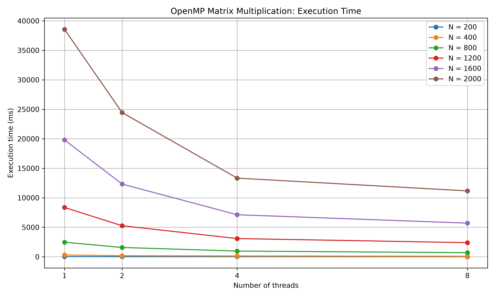
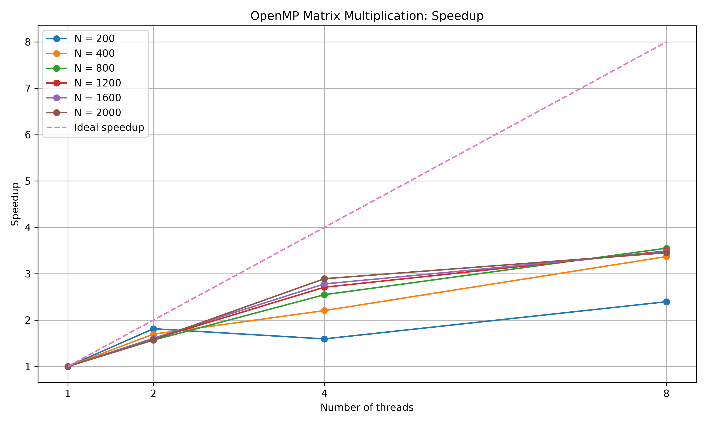

# Лабораторная работа №2 — OpenMP

Лабораторная работа по дисциплине «Параллельное программирование».

## 📌 Описание

Цель работы — исследовать производительность параллельного умножения квадратных матриц с использованием OpenMP на языке C++23.

Программа выполняет умножение матриц разных размеров и измеряет время вычислений при использовании 1, 2, 4 и 8 потоков.

## 📁 Структура проекта

- `MatrixMultiplication.cpp` — исходный код программы на C++23 с OpenMP.
- `verify.py` — проверка результатов с помощью Python и NumPy.
- `plot.py` — построение графиков производительности.
- `experiments.csv` — результаты измерений.
- `data/` — исходные матрицы.
- `results/` — результирующие матрицы для разных размеров и количества потоков.
- `performance.png` — график времени выполнения.
- `speedup.png` — график ускорения.

## ⚙️ Требования

- Visual Studio с поддержкой C++23 и OpenMP.
- Python 3.
- NumPy.
- Matplotlib.

Установка Python-библиотек:

```bash
py -m pip install numpy matplotlib
```

## 🔢 Алгоритм

Для двух квадратных матриц \(A\) и \(B\) размером \(N \times N\) вычисляется матрица \(C\):

\[
C_{ij}=\sum_{k=0}^{N-1} A_{ik}B_{kj}
\]

Распараллеливание выполняется с помощью OpenMP. Потоки обрабатывают разные строки результирующей матрицы.

## 🧪 Эксперименты

Используются размеры матриц:

- 200 × 200
- 400 × 400
- 800 × 800
- 1200 × 1200
- 1600 × 1600
- 2000 × 2000

Для каждого размера исследуются 1, 2, 4 и 8 потоков. Всего проводится 24 эксперимента.

Результаты измерений сохраняются в `experiments.csv`.

## 📊 Оценка производительности

Ускорение рассчитывается по формуле:

\[
S(p)=\frac{T(1)}{T(p)}
\]

где \(T(1)\) — время выполнения с одним потоком, а \(T(p)\) — время выполнения с \(p\) потоками.

Эффективность параллелизации:

\[
E(p)=\frac{S(p)}{p}
\]

Время выполнения и ускорение зависят от размера матрицы, характеристик процессора и накладных расходов параллельного выполнения.

### График времени выполнения



### График ускорения



## ✅ Проверка корректности

Результаты параллельных вычислений проверяются с помощью NumPy.

Проверка выполнена для 24 результатов: 6 размеров матриц и 4 варианта количества потоков.

Итог проверки: **24 из 24 тестов пройдены, ошибок нет**.

## 🚀 Запуск

1. Откройте `MatrixMultiplication.sln` в Visual Studio.
2. Включите поддержку OpenMP в настройках проекта: `C/C++ → Language → OpenMP Support → Yes (/openmp)`.
3. Соберите и запустите программу.
4. Выполните проверку:

   ```bash
   py verify.py
   ```

5. Постройте графики:

   ```bash
   py plot.py
   ```

## 📝 Вывод

В работе реализовано параллельное умножение квадратных матриц с использованием OpenMP. Проведены эксперименты для шести размеров матриц и четырёх вариантов количества потоков. Корректность результатов подтверждена сравнением с NumPy. Данные измерений и графики используются для анализа влияния числа потоков на производительность.